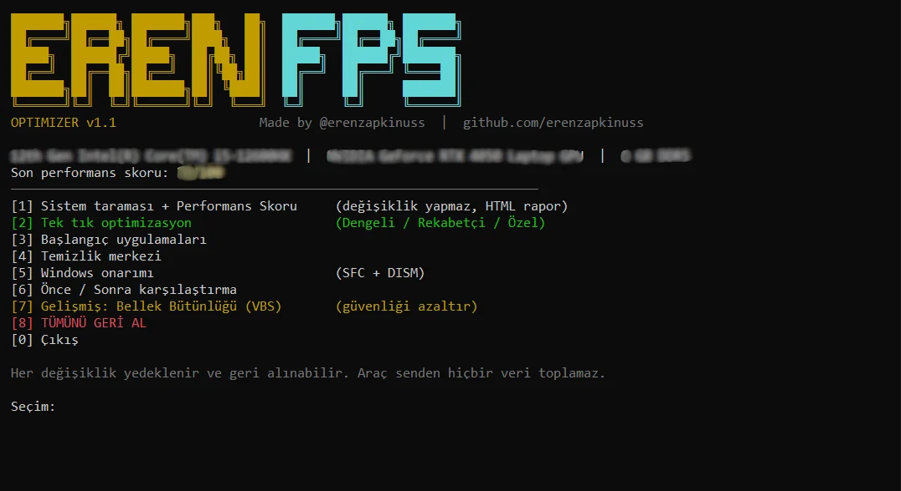
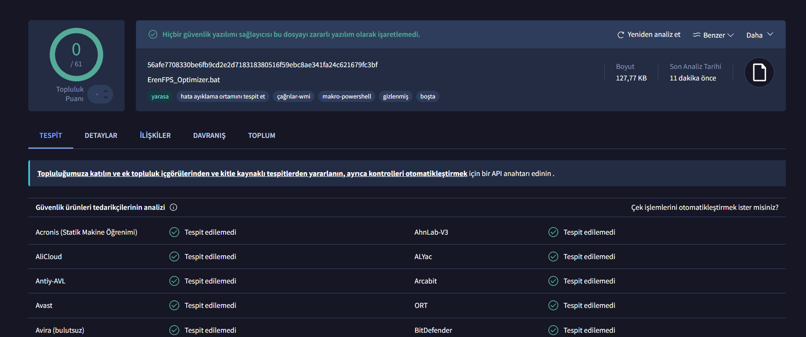
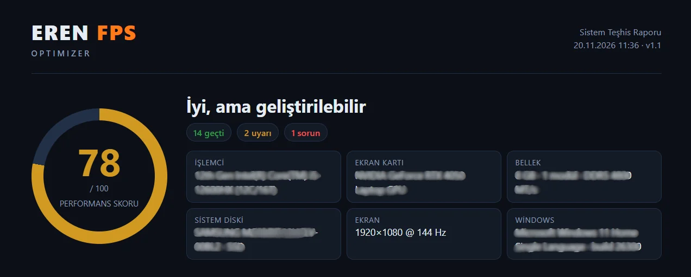
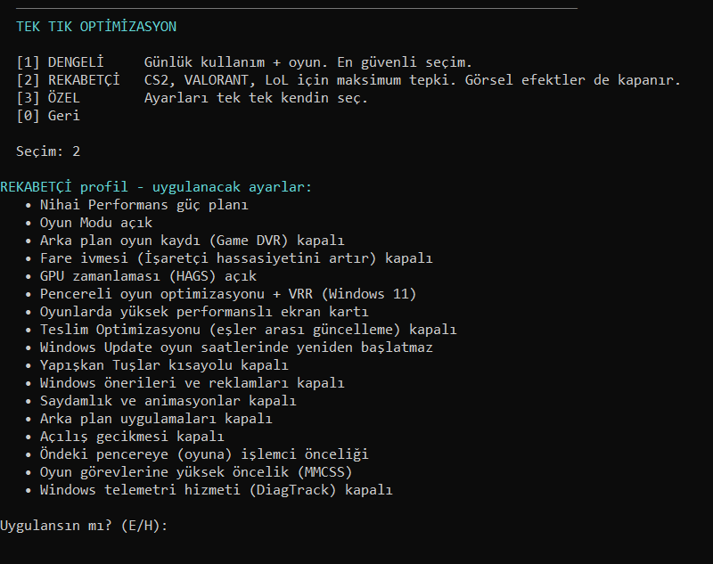
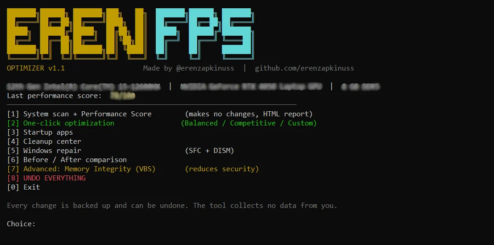

# ErenFPS Optimizer 🎮⚡

> **Made by [@erenzapkinuss](https://github.com/erenzapkinuss)**

Windows için menülü, **geri alınabilir** FPS ve performans optimizasyon aracı. Türkçe 🇹🇷 ve English 🇬🇧 arayüz.
A menu-driven, **fully reversible** FPS and performance optimizer for Windows. Turkish and English interface.



---

## 🇹🇷 Türkçe

### Ne yapar?

| Menü | İşlev |
| --- | --- |
| 1 | Sistem taraması + **Performans Skoru** (değişiklik yapmaz, HTML rapor üretir) |
| 2 | Tek tık optimizasyon: **Dengeli** / **Rekabetçi** / **Özel** (yaklaşık 25 ayar) |
| 3 | Başlangıç uygulamalarını yönetme |
| 4 | Temizlik merkezi (geçici dosyalar, shader önbelleği, Windows Update önbelleği, DISM) |
| 5 | Windows onarımı (SFC + DISM) |
| 6 | Önce / Sonra karşılaştırma |
| 7 | Gelişmiş: Bellek Bütünlüğü (VBS), güvenliği azaltır, uyarılıdır |
| 8 | **Tümünü geri al** |

Araç **bilgisayarınıza özeldir**: işlemci, ekran kartı, RAM, disk, monitör Hz ve laptop/masaüstü ayrımını çalıştığı bilgisayardan okur, ayarları ona göre sunar.

### Kullanım

1. [Releases](https://github.com/erenzapkinuss/erenfps/releases) bölümünden ya da bu depodan `ErenFPS_Optimizer.bat` dosyasını indirin.
2. Çift tıklayın. Yönetici izni isteyecek, **Evet** deyin.
3. Dili seçin ve menüden ilerleyin. Önce **1**'i çalıştırmanızı öneririz, bu hiçbir şey değiştirmez.

> Windows "SmartScreen" uyarısı çıkarsa **Ek bilgi → Yine de çalıştır** deyin. İndirilen her imzasız `.bat` dosyası için bu uyarı çıkar.

### 🔒 Güvenlik ve şeffaflık

- **Ağ bağlantısı yok.** Araç hiçbir şey indirmez, hiçbir yere veri göndermez, zamanlanmış görev ya da servis kurmaz.
- **Her değişiklik yedeklenir** ve menü **8** ile geri alınır. Değişiklikten önce Windows **geri yükleme noktası** oluşturulur.
- Windows Defender / güvenlik duvarını **kapatmaz**. Riskli bir ayar (Bellek Bütünlüğü) ayrı menüde, uyarı ve onayla.
- **Kaynak kodu paylaşılmıyor.** Araç tek bir `.bat` dosyası olarak dağıtılır. Bazı antivirüsler bu tür dosyalarda **yanlış alarm** verebilir (aşağıya bakın).
- Aracı kullanmadan önce bir geri yükleme noktası oluşturmanızı öneririz. **Kullanım sorumluluğu size aittir.**

### 🧪 VirusTotal ve doğrulama

| Dosya | SHA-256 |
| --- | --- |
| `ErenFPS_Optimizer.bat` | `56afe7708330be6fb9cd2e2d718318380516f59ebc8ae341fa24c621679fc3bf` |

- **VirusTotal sonucu:** [`ErenFPS_Optimizer.bat` taraması](https://www.virustotal.com/gui/file/56afe7708330be6fb9cd2e2d718318380516f59ebc8ae341fa24c621679fc3bf)
  *(Bu bağlantı, dosya VirusTotal'a yüklenince çalışır. Sonuç ekran görüntüsü: aşağıda.)*



İndirdiğiniz dosyanın özgün olduğunu doğrulamak için PowerShell'de:

```powershell
Get-FileHash .\ErenFPS_Optimizer.bat -Algorithm SHA256
```

Çıkan değer yukarıdakiyle aynı olmalı.

**Yanlış alarm hakkında:** Base64 gömülü PowerShell, yönetici izni isteme ve kayıt defteri ayarı değiştirme, performans araçlarında antivirüs sezgilerini tetikleyen tipik özelliklerdir. Bir antivirüs uyarırsa ve aracın güvenliğinden emin değilseniz çalıştırmayın.

### 📸 Ekran görüntüleri

| Ana menü | Sistem raporu | Optimizasyon |
| --- | --- | --- |
|  |  |  |

| English menu |
| --- |
|  |

---

## 🇬🇧 English

### What it does

| Menu | Function |
| --- | --- |
| 1 | System scan + **Performance Score** (makes no changes, creates an HTML report) |
| 2 | One-click optimization: **Balanced** / **Competitive** / **Custom** (about 25 tweaks) |
| 3 | Manage startup apps |
| 4 | Cleanup center (temp files, shader cache, Windows Update cache, DISM) |
| 5 | Windows repair (SFC + DISM) |
| 6 | Before / After comparison |
| 7 | Advanced: Memory Integrity (VBS), reduces security, with warnings |
| 8 | **Undo everything** |

The tool is **device-aware**: it reads your CPU, GPU, RAM, disk, monitor refresh rate and laptop/desktop type from the machine it runs on and offers tweaks accordingly.

### Usage

1. Download `ErenFPS_Optimizer.bat` from this repository or the [Releases](https://github.com/erenzapkinuss/ErenFPS_Optimizer/releases/tag/v1.1) page.
2. Double-click it and accept the administrator prompt.
3. Pick a language and use the menu. Start with **1**, it changes nothing.

> If Windows SmartScreen warns you, click **More info → Run anyway**. Any unsigned `.bat` downloaded from the internet triggers it.

### 🔒 Safety and transparency

- **No network access.** It downloads nothing, sends no data, installs no scheduled tasks or services.
- **Every change is backed up** and can be undone with menu **8**. A Windows **restore point** is created first.
- It does **not** disable Windows Defender or the firewall. The one risky tweak (Memory Integrity) lives in a separate menu with a warning and confirmation.
- **Source code is not published.** The tool is distributed as a single `.bat` file. Some antivirus products may raise **false positives** on such files.
- Create a restore point before use. **Use at your own risk.**

### Verification

The SHA-256 hash and the [VirusTotal report](https://www.virustotal.com/gui/file/56afe7708330be6fb9cd2e2d718318380516f59ebc8ae341fa24c621679fc3bf?nocache=1) are listed in the Turkish section above. Verify your download with `Get-FileHash`.

---

## License

[All rights reserved](LICENSE) © erenzapkinuss
